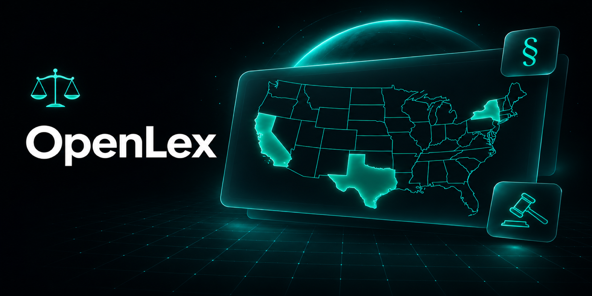

<p align="center">
  
</p>

<p align="center">
  <a href="https://doi.org/10.5281/zenodo.24259139"></a>
  <a href="./LICENSE"></a>
  
  
  
</p>

Open-source jurisdiction mapping engine for U.S. law. Given a legal topic and location, returns applicable statutes, regulations, governing bodies, courts, and preemption rules with real citations and official source URLs.

## Quick Start

```bash
pnpm install
pnpm build
```

### Use the API

```bash
pnpm --filter @allem-law/api start
# API running at http://localhost:3000
```

```bash
# Get California security deposit law
curl http://localhost:3000/statutes/ca/security-deposits

# Compare minimum wage across all 50 states
curl http://localhost:3000/compare?topic=minimum-wage

# Get comparison as CSV
curl http://localhost:3000/compare?topic=minimum-wage&format=csv

# Get GeoJSON for choropleth mapping
curl "http://localhost:3000/compare?topic=minimum-wage&format=geojson&column=standard_rate"

# Parse a legal citation
curl -X POST http://localhost:3000/citations/parse \
  -H "Content-Type: application/json" \
  -d '{"citation": "42 U.S.C. § 1983"}'

# Format a citation in plain English
curl "http://localhost:3000/citations/format?citation=U.S.+Const.+amend.+XIV&format=plain-english"
# → "Fourteenth Amendment to the United States Constitution"

# Get New York court hierarchy
curl http://localhost:3000/courts/ny

# Check preemption rules for employment law
curl http://localhost:3000/preemption/employment

# Full-text search
curl http://localhost:3000/search?q=security+deposit+return
```

### Use as a library

```typescript
import { queryJurisdiction, AuthorityRegistry } from "@allem-law/core";
import { ALL_TOPICS, loadStatuteEntries } from "@allem-law/statutes";

// Load all statute data into the registry
const registry = new AuthorityRegistry();
for (const topic of ALL_TOPICS) {
  for (const entry of loadStatuteEntries(topic)) {
    registry.registerStatute(entry);
  }
}

// Query: what law governs security deposits in California?
const result = queryJurisdiction({
  topic: "security deposits",
  state: "ca",
  includeFederal: true,
}, registry);
// → Cal. Civ. Code § 1950.5 with key provisions, penalties, source URLs
```

### Use with React

```tsx
import { OpenLexProvider, useStatutes, JurisdictionPicker, StatuteCard } from "@allem-law/react";

function App() {
  const [state, setState] = useState("ca");
  const { data, loading } = useStatutes("security-deposits", state);

  return (
    <OpenLexProvider baseUrl="http://localhost:3000">
      <JurisdictionPicker value={state} onChange={setState} />
      {data?.map(s => <StatuteCard key={s.id} statute={s} />)}
    </OpenLexProvider>
  );
}
```

## What It Does

| Query | Returns |
|-------|---------|
| `topic: "minimum wage", state: "TX"` | Tex. Lab. Code Ch. 62, FLSA floor preemption, DOL |
| `topic: "security deposits", state: "CA"` | Cal. Civ. Code § 1950.5 with 21-day return deadline, 1-month limit |
| `topic: "non-compete", state: "CA"` | Cal. Bus. & Prof. Code § 16600 — non-competes void |
| `topic: "DUI", state: "UT"` | Utah Code § 41-6a-502 — 0.05 BAC (lowest in nation) |
| `topic: "marijuana", state: "CO"` | Colo. Const. art. XVIII § 16 — recreational legal |
| `compare: "small-claims"` | 50-state matrix: $2,500 (KY) to $25,000 (TN/DE) |

## Packages

| Package | Description |
|---------|-------------|
| `@allem-law/core` | Types, jurisdiction model (56 jurisdictions), topic taxonomy (30+ topics), query engine, temporal resolver |
| `@allem-law/statutes` | **510 statute entries** across 10 topics, citation parser (15 formats), cross-state comparison with extractors, GeoJSON output |
| `@allem-law/regulations` | Federal agency database (9 agencies), **45 preemption rules** across 8 domains, **293 state regulatory agencies** |
| `@allem-law/courts` | **51 state court hierarchies** + **94 federal district courts**, venue determination, court search |
| `@allem-law/search` | Full-text TF-IDF inverted index across all statutes and regulations |
| `@allem-law/export` | JSON, CSV, Markdown, **LaTeX** (booktabs/longtable), Bluebook citation lists, legal research memos |
| `@allem-law/api` | **REST API** with 10 endpoints (Hono), CORS, caching, multiple output formats |
| `@allem-law/react` | **6 hooks** + **4 components** — useStatutes, useCompare, useSearch, JurisdictionPicker, ComparisonTable |

## Statute Data Coverage

510 entries covering all 50 states + DC across 10 high-demand legal topics:

| Topic | Key Data Points | Federal Baseline |
|-------|----------------|-----------------|
| Security Deposits | Max amount, return deadline, itemization, penalties | None (state-only) |
| Minimum Wage | State rate, tipped rate, scheduled increases | FLSA $7.25/hr |
| Non-Compete | Enforceability status, income thresholds, duration limits | FTC proposed rule (stayed) |
| DUI/DWI | BAC limit, first offense penalties, ignition interlock | 0.08 BAC standard |
| LLC Formation | Filing fee, annual fee, operating agreement, publication req | None |
| Statute of Limitations (PI) | General PI years, med mal years, discovery rule | None |
| Small Claims | Dollar limit, attorneys allowed, appeal rights | None |
| Marijuana Legality | Recreational, medical, possession limits, retail | Schedule I (federal) |
| Concealed Carry | Permit type, training required, permit fee | Second Amendment |
| Divorce Grounds | No-fault, fault grounds, waiting period, residency req | None |

Every entry includes real citations, official government source URLs, key provisions, penalties, and structured monetary values.

## Features

- **510 statute entries** with real citations and official source URLs for all 50 states + DC
- **15 citation formats** — U.S.C., C.F.R., state codes, constitutions, session laws, executive orders, case law, municipal codes, AG opinions
- **3 citation output styles** — Bluebook, ALWD, and plain-English formatting
- **50-state comparison engine** — structured matrices with per-topic extractors, summary statistics, and outlier detection
- **45 preemption rules** — express, field, conflict, floor, and ceiling preemption across employment, privacy, firearms, marijuana, immigration, environment, housing
- **51 state court hierarchies** — handles NY ("Court of Appeals" is highest), TX/OK (dual highest courts), MD (2023 renames), plus 94 federal district courts
- **73 statute versions** — temporal queries like "what was minimum wage in CA on Jan 1, 2022?"
- **293 state agencies** — labor departments, attorneys general, real estate commissions, insurance commissioners, cannabis regulators, bar associations
- **28 municipal ordinances** — rent control, local minimum wage, short-term rentals, paid sick leave for top cities
- **GeoJSON output** — choropleth-ready data with FIPS codes for Mapbox, Leaflet, D3.js
- **Publication-quality export** — LaTeX tables (booktabs), Bluebook citation lists, legal research memos
- **REST API** — 10 endpoints with OpenAPI-style routing, CORS, caching
- **React SDK** — hooks (useStatutes, useCompare, useSearch) + components (JurisdictionPicker, ComparisonTable, CourtHierarchy)
- **Data freshness tracking** — automated staleness detection with CI validation

## API Endpoints

| Method | Path | Description |
|--------|------|-------------|
| `GET` | `/health` | Service health + data stats |
| `GET` | `/query?topic=X&state=Y` | Main jurisdiction query |
| `GET` | `/statutes/:topic` | All states for a topic |
| `GET` | `/statutes/:state/:topic` | Single state + topic |
| `GET` | `/compare?topic=X&format=json\|csv\|markdown\|geojson` | 50-state comparison |
| `GET` | `/courts/:state` | Court hierarchy |
| `GET` | `/search?q=X` | Full-text search |
| `POST` | `/citations/parse` | Parse a citation |
| `GET` | `/citations/format?citation=X&format=bluebook\|alwd\|plain-english` | Format a citation |
| `GET` | `/preemption/:topic` | Preemption rules |

## Tech Stack

- [TypeScript](https://www.typescriptlang.org/) (strict mode)
- [Turborepo](https://turbo.build/) + [pnpm](https://pnpm.io/) workspaces
- [Hono](https://hono.dev/) (API server)
- [React](https://react.dev/) 18+/19 (frontend SDK)
- [Vitest](https://vitest.dev/) (testing)
- [Changesets](https://github.com/changesets/changesets) for versioning

## Development

```bash
git clone https://github.com/kingofmit/openlex.git
cd openlex
pnpm install
pnpm build
pnpm test
```

Start the API in dev mode:
```bash
pnpm --filter @allem-law/api dev
```

See [CONTRIBUTING.md](./CONTRIBUTING.md) for more details.

## Disclaimer

OpenLex provides legal information, not legal advice. This data is for informational and educational purposes only. Consult a licensed attorney for advice on your specific situation.

## Support

If you find OpenLex useful, consider supporting its development:

<a href="https://buymeacoffee.com/kingofmit" target="_blank"></a>

## License

[MIT](./LICENSE) - [Ahmed Allem](https://kingallem.com)
